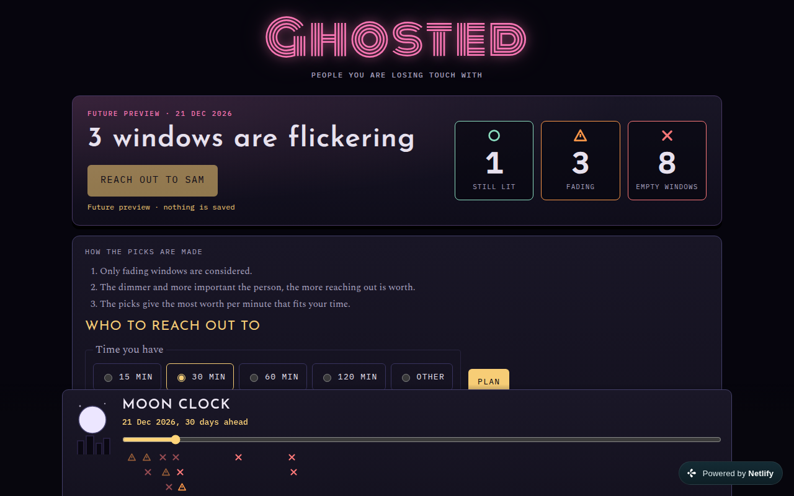
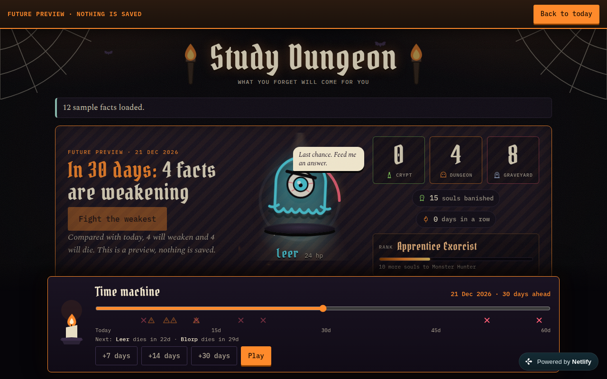
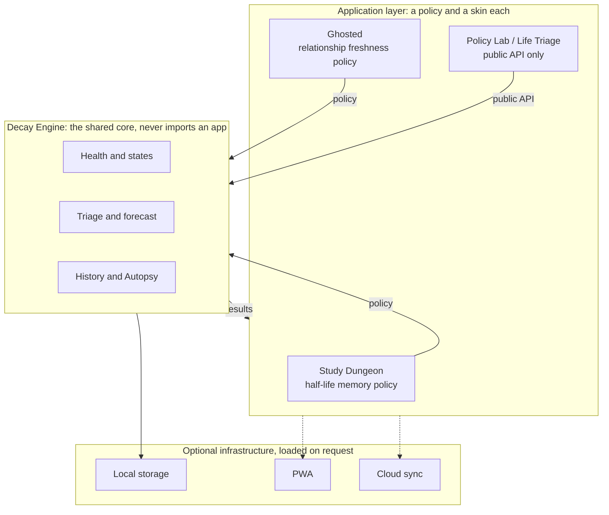

# Decay Engine

[](https://github.com/Shree-nidhi904/DecayEngine/actions/workflows/check.yml)

### A hospital for the things in your life: one engine for things that fade, die, and can be brought back.

**Start here: [decay-engine.pages.dev](https://decay-engine.pages.dev)**, one page with the pitch and every live app.

**The two flagship apps** (start here):

| | Live | In one line |
|---|---|---|
| **Study Dungeon** | [open](https://decay-engine-study-dungeon.pages.dev) | Facts you study fade into monsters. Review them before they die. |
| **Ghosted** | [open](https://decay-engine-ghosted.pages.dev) | A street of windows, one per person. Each light shows how recently you were in touch. |

**Two supporting tools** on the same engine:

| | Live | What it demonstrates |
|---|---|---|
| **Policy Lab** | [open](https://decay-engine-lab.pages.dev) | For developers: write your own decay rules and watch the real engine run them. |
| **Life Triage** | [open](https://decay-engine-life-triage.pages.dev) | Across apps: one time budget for your facts and your friends. |

Built for [Kiroween 2026](https://kiroween.devpost.com/) in the **Skeleton Crew** category: one reusable foundation, proved by two very different apps built on top of it.

<p>
  
  
</p>

**Jump to:** [60-second tour](#judges-a-60-second-tour) · [The idea](#the-idea) · [The engine](#the-engine) · [Study Dungeon](#app-1-study-dungeon) · [Ghosted](#app-2-ghosted) · [Proof of reuse](#proof-of-reuse) · [How Kiro was used](#how-kiro-was-used) · [Quality](#quality-and-tests) · [Run it](#running-it) · [Cloud sync](#cloud-sync-optional)

---

## Judges: a 60-second tour

1. **Ghosted.** Open [the live app](https://decay-engine-ghosted.pages.dev), choose **Load sample street**, and drag the moon clock forward. Windows flicker, then go dark. Nothing is saved while you look ahead.
2. **Study Dungeon.** Open [the live app](https://decay-engine-study-dungeon.pages.dev), choose **Load sample data**, and set the Triage budget to 20 minutes. It tells you exactly which facts to save.
3. **Policy Lab.** Open [the lab](https://decay-engine-lab.pages.dev), edit a decay policy, and watch the real engine run it. This is the "one policy and a skin makes a new app" claim, in your hands.
4. **The proof.** Run `bash scripts/check.sh`. Its second line, `engine unchanged`, shows that Ghosted needed no change to the engine.
5. **The Kiro evidence.** [`.kiro/`](.kiro) (specs, steering, hooks, a custom agent), then [docs/KIRO_LOG.md](docs/KIRO_LOG.md) and [docs/KIRO_WRITEUP.md](docs/KIRO_WRITEUP.md).

Everything runs in your browser. By default there are no accounts, no server and no network calls.

---

## The idea

Some things get worse quietly when nobody is looking at them.

- A fact you studied last month is half gone today.
- A friend you used to talk to every week has not heard from you since spring.
- The milk in the fridge and the passport in the drawer both have a date you are not tracking.

They look like different problems, but they have the same life:

```
ALIVE        healthy
  ↓
WEAK         fading, needs attention
  ↓
DEAD         moved to the graveyard
  ↓
RESURRECTED  back to ALIVE
```

Today each one is solved by a separate app that rebuilds the same logic from scratch: health tracking, "what needs attention now", a list of dead things, a history of what happened. **Decay Engine writes that logic once.** An app supplies only the rules of its own decay and its own look.

## The engine

`packages/engine` is a small TypeScript library with no UI code and no runtime dependencies. It does not know what an item is. It does not know about studying, friends or food. An app plugs in by answering four questions about its items. The set of answers is called a **decay policy**:

| Question | In code |
|---|---|
| How healthy is it now? | `healthAt(item, now)` |
| Something happened. What now? | `applyEvent(item, event, now)` |
| When should we look again? | `nextDueAt(item, now)` |
| Can it come back? | `resurrect(item, event, now)` |

In return, every app gets the same tools:

| Function | What it does |
|---|---|
| `addItem`, `tend`, `edit` | Start tracking an item, record that something happened, change its details |
| `tick` | Recalculate health for everything and move items between states |
| `due`, `graveyard` | What needs attention now, and what has died |
| `resurrect` | Try to bring a dead item back |
| `history` | Everything that ever happened to an item |
| `triage` | "I have N minutes. What should I save?" |
| `autopsy` | The facts behind an item's death |
| `forecast` | What will die within any horizon you give it |

**The rule that keeps it honest:** the engine never imports an app. If an app needs the engine changed, the policy contract is wrong, and the contract gets fixed instead. A test reads the engine's source and fails on a clock, a browser call (outside one storage adapter), an app import, or a runtime dependency.

### Three features every app gets for free

**Triage: "I have 20 minutes. What should I save?"** You say how much time you have. Triage looks at everything fading and picks, exactly, the set worth saving first that fits your time. Each item is scored the same way in every app:

```
value = health you would restore × how close it is to dying × importance
```

Importance (1 to 3) and cost in minutes are set by you. The engine never decides what matters to you. The pick is an exact 0/1 knapsack, checked against brute force by property tests.

**Autopsy: why did this die?** Every change is written to a history log. When an item dies, the autopsy reads that log and reports facts: when it started fading, when it was last tended, how long the silence lasted, and how close you came to saving it. The engine reports facts; each app turns them into its own words.

**The time machine.** Decay is slow, and nobody wants to wait three weeks to see whether an app works. Every engine function takes the current time as an input instead of reading the clock. So each app has a **time slider**: drag it forward 30 days and watch items weaken and die in seconds, drag it back and they recover. Nothing is saved while you look into the future. The same idea gives the **forecast** almost for free.

### The haunt pass: the world reacts

Built from its own spec ([`.kiro/specs/haunt-pass`](.kiro/specs/haunt-pass/requirements.md)), the same in both apps:

- **Watch it die as you scrub.** Drag the time machine and each window or card plays the moment it fades or dies. Lightning strikes on a death.
- **Doom.** The whole scene gets darker as more things fade, and brightens again when you tend them.
- **A guide with some mischief.** Wisp (Ghosted) and the Keeper (Study Dungeon) say one line about what is happening and what to tap next.
- **The rescue is a moment.** Reconnecting or resurrecting plays a ring of light, rising spirits and a stamp.
- **Share a card.** A picture of your street or dungeon tonight, made on your device. Ghosted shows no names unless you ask.
- **Spooky level.** Calm turns off lightning and the ambient extras. Reduced motion is respected everywhere.

---

## App 1: Study Dungeon

**Who it is for:** anyone learning facts they need to keep, such as exam material, vocabulary or interview prep.

**What it solves:** people forget most of what they study unless they review it at the right time. Study Dungeon shows which facts are about to slip away and makes reviewing them a short fight.

**Look:** a dungeon lit by candles. A fading fact comes back as a monster.

| Question | Study Dungeon's answer |
|---|---|
| What is an item? | A fact: a question and its answer |
| How healthy is it now? | Halves every half-life since the last review |
| Something happened | Right answer: back to 100 and the half-life doubles. Wrong answer: drops to 45 and the half-life halves |
| When to look again? | When health is predicted to fall below 60 |
| Can it come back? | Yes, by answering it right |

A fact you keep getting right earns a longer half-life, so you see it less often. A fact you keep missing comes back sooner.

**More.** A second, optional **Memory model** policy (spacing effect and per-fact difficulty), import from pasted lines, CSV and Anki exports, and the three lists (the Crypt, the Dungeon and the Graveyard) are described in [docs/STUDY_DUNGEON.md](docs/STUDY_DUNGEON.md).

## App 2: Ghosted

**Who it is for:** anyone who wants to stay in touch with people and keeps meaning to.

**What it solves:** contact fades without anyone deciding it should. Ghosted shows who you have not been in touch with for longer than your usual rhythm, before the gap becomes awkward.

**Look:** a street of windows. Each window is a person, and its light shows how recently you were in touch.

| Question | Ghosted's answer |
|---|---|
| What is an item? | A person you want to stay in touch with |
| How healthy is it now? | Falls in a straight line, reaching 0 at three times their usual rhythm |
| Something happened | A quick text adds 40. A call or a meet-up restores 100 |
| When to look again? | When freshness falls below 60 |
| Can it come back? | Yes, if they reply |

Ghosted measures **connection freshness**: how recently you were in touch. It never measures how much someone matters, and its wording never says that a light does.

The three lists are **Still lit**, **Fading** and **Empty windows**.

**Built.** Ghosted runs on the same engine as Study Dungeon, with **zero changes to `packages/engine`**. What it has:

- **The street:** each person is a window on a house, grouped by relationship ("Others" for people with no tag). The window's light is `health / 100`; a fading window flickers, a dark one is boarded up. Every state is shown three ways: light, glyph (circle, triangle, cross) and word (lit, flickering, boarded up; "lit again" after a reconnect).
- **The hero** says who needs attention and offers one action, such as "Reach out to Dan".
- **Reach out** logs a real contact (sent a message, had a call or met up) and shows the freshness before and after. **Reconnect** brings a dark window back, fully lit, when they reply. **Autopsy** charts the last life with a marker per contact and explains in words how the window went dark.
- **Triage** with 15, 30, 60 or 120 minutes (or your own number), **a forecast** of who goes dark in 7, 30 or 90 days, and **the moon-clock dock**: a time machine that looks up to a year ahead, with a marker for each person's fade and dark day. Nothing is saved while you look ahead.
- **Back up, restore and import:** a JSON backup file, and import from pasted lines (`name | relationship | rhythm days | last contact`).
- A short splash once per tab (never under reduced motion), a neon sign, and every animation behind `prefers-reduced-motion`.

To fit Ghosted, the shared shell gained **three optional additions**, each off by default, so Study Dungeon is unchanged:

| Shell component | Optional addition |
|---|---|
| `TimeMachine` | `maxDays` and `jumpDays`: Ghosted uses 365 days and jumps of +30, +90, +180 days and +1 year |
| `TriagePanel` | `budgets` and `defaultBudget`: Ghosted offers 15, 30, 60 and 120 minutes |
| `AutopsyDialog` | `markers`, `renderMarker` and `markerSummary` for the app's own chart markers (here text, call and meet-up), plus `focusContentOnOpen` |

---

## Proof of reuse

The two apps decay in different ways, and the same engine runs both:

| | Study Dungeon | Ghosted |
|---|---|---|
| Shape of decay | Exponential (half-life) | Straight line |
| What slows it | Getting answers right | Staying in touch |
| Coming back | A test of you | A reply from them |
| Look | A dungeon lit by candles | A street of windows at night |

Ghosted was the test of the claim. It needed a new policy and a new skin, and nothing else. `scripts/check.sh` runs `scripts/check-engine-unchanged.sh`, which compares `packages/engine` (and the shell's allowed files) with the commit before the Ghosted work, and **fails on any other change**. The baseline is the `engine-complete` tag; both apps came after it. Only whole-line comments are ignored.

To add your own app, see [docs/ADDING_A_POLICY.md](docs/ADDING_A_POLICY.md). A third app, such as food and subscription expiry, would be the same job again: one policy and one skin.

### Beyond the two apps

Two small tools show the engine on its own. Both use only its public API, and the engine-unchanged check still passes.

**Policy Lab** (`apps/policy-lab`): the reuse claim, made hands-on. Edit a decay policy as a short JavaScript object, with a sample item and event, and the real `DecayEngine` runs it over simulated days. A chart shows the item going from alive to weak to dead, and `checkPolicy` says whether the rules are sound. It ships with a milk carton (a straight line, like Ghosted), a fact (a half-life, like Study Dungeon) and a deliberately broken policy that `checkPolicy` rejects. The policy text is run in your own browser with `new Function`, so only paste code you trust.

**Life Triage** (`apps/life-triage`, on the package `@decay-engine/life-triage`): one time budget for facts and friends together. The package asks each engine for its weak items through `engine.triage`, then picks the best set across both with one exact knapsack under the same value rule both apps use. It also shows what an even split of your time between the two apps would have kept. Load a Back up file from each app, read both saves from your account, or use **Sample data**. Nothing is uploaded; the files are read in the page.

### Architecture



Folder layout, the rules and the shell additions are in [docs/ARCHITECTURE.md](docs/ARCHITECTURE.md).

| Part | Choice |
|---|---|
| Engine | TypeScript (strict), no UI code, no runtime dependencies, time passed in as an input |
| Tests | Vitest unit and outcome tests, and fast-check property-based tests |
| Apps | React with Vite, in a pnpm monorepo, CSS and SVG only |
| Storage | The browser's local storage by default: no accounts, no login, no server. Optional cloud sync with your own Supabase project |
| Hosting | Cloudflare Pages |

---

## How Kiro was used

The project is built with [Kiro](https://kiro.dev), and the `.kiro/` folder is committed on purpose.

| Kiro feature | How it was used | Where to look |
|---|---|---|
| **Specs** | Requirements, design and tasks, with a review stop after each step, for the engine, Study Dungeon, Ghosted, the haunt pass, Insight and the extensions. The first three alone are about 7,700 lines. | [`.kiro/specs/`](.kiro/specs) |
| **Steering** | Eleven files. `engine-boundary.md` became a test that fails on any violation. `no-fake-tests.md` forbids weakening a test to make it pass. `authorship.md` records which tool wrote which file. | [`.kiro/steering/`](.kiro/steering) |
| **Hooks** | Run the engine tests on save, check an app's policy when its policy file is saved, and scaffold a new policy on request. | [`.kiro/hooks/`](.kiro/hooks) |
| **Custom agent** | `policy-reviewer`: read-only, checks a policy against the contract, the steering and the spec. On its first run it found a real conflict between a requirement and the design that had been missed by hand. | [`.kiro/agents/`](.kiro/agents) |
| **MCP** | Context7 for library docs, and Playwright to measure the apps in a browser at 1280, 390 and 320 pixels wide. | [`.kiro/settings/mcp.json`](.kiro/settings/mcp.json) |
| **Power** | A Cloudflare Pages deployment power. | [`.kiro/powers/`](.kiro/powers) |
| **Property-based testing** | The engine's rules (below) are properties, not examples. | [`packages/engine/tests`](packages/engine/tests) |
| **Kiro IDE and CLI** | The IDE built from the specs. The CLI ran the checks and measured the result in a browser. | [docs/KIRO_WRITEUP.md](docs/KIRO_WRITEUP.md) |

**Who wrote what, honestly.** The decay rules are mine, set in the specs. **Not all of the code was written in Kiro.** Claude Code (Anthropic's CLI agent), run outside Kiro at my request, wrote the `DecayEngine` class, the Triage selection, the Autopsy analysis, the engine's property-based tests, Study Dungeon's policy and cause-of-death sentences, Ghosted's cause-of-death sentences, and a visual pass for Study Dungeon. That was a choice about who owns the rules. Kiro wrote the rest of the engine from the spec, most of the UI, the app glue and most of the tests. For Ghosted's policy, Kiro wrote the code from formulas I fixed in the spec, and I checked it with `policy-reviewer` and the tests. Every file written outside Kiro carries a header comment saying so, and [`.kiro/steering/authorship.md`](.kiro/steering/authorship.md) lists them all.

**The log.** Every session is recorded in [docs/KIRO_LOG.md](docs/KIRO_LOG.md): what Kiro produced, what was changed by hand, what went wrong, and the credits used. The write-up, including the mistakes that Kiro and review caught (for example Kiro inventing its own policy contract in an early steering update, and running a global git config change without asking), is in [docs/KIRO_WRITEUP.md](docs/KIRO_WRITEUP.md).

---

## Quality and tests

The suites are not just example assertions:

- **Unit tests** check single operations.
- **Property tests** (fast-check) check rules over generated inputs: health stays between 0 and 100, a dead item is never due, the same input gives the same answer, Triage never exceeds the budget and equals the brute-force optimum, and looking ahead never changes saved data. Each generator has a coverage test, so a property cannot pass by never generating the interesting cases.
- **Outcome tests** check exact results, for example: "a Ghosted contact with a 30-day rhythm goes dark just after day 81 if you never get in touch".
- **Source checks** read the code itself: the engine imports no app and reads no clock, and the apps make no network call by default.
- **Build checks** run every production build and the default bundles.

Details: [docs/TESTING.md](docs/TESTING.md).

| Package | Tests |
|---|---|
| Engine | 701 |
| Shell | 167 |
| Study Dungeon | 863 |
| Ghosted | 1,092 |
| Policy Lab | 35 |
| Life Triage (package and app) | 61 |
| Insight | 74 |
| Persist, PWA, Cloud | 149 |
| **Total** | **3,142** |

Counts are from the last full run of `bash scripts/check.sh`, on Nov 28.

`bash scripts/check.sh` runs all of it: install, the engine-unchanged check, every typecheck, every test suite, every production build, a check on the default bundles, and the landing page. The same script runs in [CI](.github/workflows/check.yml) on every push.

## Build status

- [x] Engine spec: requirements, design, tasks
- [x] Steering, hooks and the `policy-reviewer` agent
- [x] Engine and its tests
- [x] Study Dungeon, with a second memory model and CSV / Anki import
- [x] Ghosted, with the engine unchanged
- [x] The haunt pass in both apps
- [x] `@decay-engine/insight`: replay and what-if
- [x] Policy Lab and Life Triage
- [x] Optional cloud sync, notifications and PWA
- [x] Deployed sites
- [x] Kiro write-up: [docs/KIRO_WRITEUP.md](docs/KIRO_WRITEUP.md)
- [ ] Demo video

## Running it

You need Node 20.19 or later (22.12+ recommended) and pnpm.

```bash
pnpm install

# Study Dungeon, with hot reload: open the address it prints (http://localhost:5173)
pnpm --filter @decay-engine/study-dungeon dev

# Or the production build, served locally (http://localhost:4173)
pnpm --filter @decay-engine/study-dungeon build
pnpm --filter @decay-engine/study-dungeon preview

# Ghosted, with hot reload: open the address it prints
pnpm --filter @decay-engine/ghosted dev

# Ghosted's production build, served locally from the site root
pnpm --filter @decay-engine/ghosted build
pnpm --filter @decay-engine/ghosted preview

# Ghosted's tests only
pnpm --filter @decay-engine/ghosted test

# Policy Lab and Life Triage, with hot reload
pnpm --filter @decay-engine/policy-lab dev
pnpm --filter @decay-engine/life-triage-app dev

# Every check: install, typechecks, the engine unchanged, all tests, and the builds
bash scripts/check.sh
```

On first open, Study Dungeon offers **Load sample data** (12 facts: 4 alive, 4 weak, 4 dead) or **Start empty**. Ghosted offers **Load sample street** (12 made-up people: 4 lit, 4 flickering, 4 boarded up) or **Start empty**. Each app saves in this browser's local storage under its own keys, and its **Reset all data** clears only its own.

## Cloud sync (optional)

Off by default: with no settings in the build, the apps make no network request at all. To use it you bring your own [Supabase](https://supabase.com) project. It offers revision-checked sync across devices, an optional passphrase that encrypts the cloud copy on your device first (AES-256-GCM, key from PBKDF2), privacy-preserving notifications, and an installable offline PWA. Setup and limits: [docs/CLOUD.md](docs/CLOUD.md) and [docs/PUSH_SETUP.md](docs/PUSH_SETUP.md).

## Licence

[MIT](LICENSE). Everything stays in your browser. Names and items in the samples are made up.
